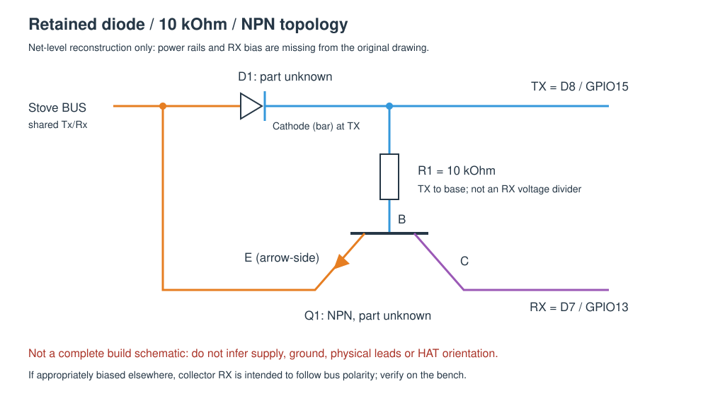
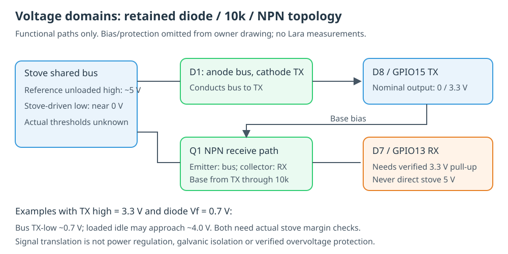

# Diode, resistor and NPN: the one-wire serial adapter

[README](../README.md) · [hardware](hardware.md) · [protocol](protocol.md) · [firmware and OTA](esphome.md)

This page documents the owner's retained **one diode + one 10 kΩ resistor +
one NPN transistor** drawing. It separates that evidence from the conflicting
MOSFET reference previously used in this documentation, and explains the
ESP8266 UART assignments. This is a serial interface to the stove/display bus,
not a Dallas/Maxim 1-Wire interface and not standard RS232.

**Important:** the drawing omits supply/ground and receive biasing. It establishes
three signal nets and a resistor value, but is not a complete, electrically
validated construction schematic. Physical HAT contact positions, green-wire
identity, transistor part/lead order and stove connector pins remain unresolved.
Do not infer how to insert the ESP from this diagram.
The owner has since confirmed insertion direction privately; this does not
verify the electrical levels. See [voltage margins below](#11-voltage-levels-and-error-mechanisms)
for what the circuit is expected to do and what remains to be measured on Lara.

## 1. Configuration A: the retained diode/resistor/NPN drawing

Figure 1 is an independently redrawn net-level interpretation of the owner's
saved schematic. It is not a photograph of the HAT and does not add missing
power rails or an assumed receive pull-up.



**Figure 1:** D1 connects the shared bus to the transmit node, with its cathode
bar at TX. R1 connects TX to Q1's base; Q1's arrow-side emitter connects to the
bus and its collector connects to RX. The original drawing labels Q1 as NPN.
These are transistor terminal names, not physical package pin numbers.

| Item | Evidence-backed value / connection | Not established |
|---|---|---|
| D1 | Diode; anode on shared `Tx/Rx`, cathode/bar on `Tx` | Part number, silicon versus Schottky, ratings |
| R1 | **10 kΩ**, between `Tx` and Q1 base | As-built measured resistance, tolerance, power rating |
| Q1 | **NPN**, emitter to bus, collector to `Rx`, base through R1 to `Tx` | Part number, package, B/C/E lead order, ratings |
| `Tx` | ESP sends to adapter; **D8 / GPIO15** | Physical HAT contact |
| `Rx` | Adapter sends to ESP; **D7 / GPIO13** | Physical HAT contact and receive bias/protection |
| `Tx/Rx` | Stove's bidirectional serial bus | Stove/DB9 connector contact |
| Supply and ground | Not shown in the saved circuit | Power source, regulator paths, signal ground, isolation |

Do not replace Q1 with a BSS138: that is a MOSFET, not an NPN transistor.
Likewise, neither a BC547 nor a 2N3904 is identified by the evidence. Both are
examples of small-signal NPN families, but cannot be specified as the installed
part; their package pinouts can differ. BAT85/1N5817 are parts proposed for the
separate reference circuit, **not identified parts of this HAT**.

### Intended signal behavior and missing conditions

When TX is low and the bus is high, D1 can conduct from bus to TX, pulling the
bus toward the TX low level plus the diode's forward drop. That drop depends
on the actual diode and current; a part number cannot be chosen from a symbol.
When the bus is low and TX is high, D1 is reverse-biased.

With Q1 wired as drawn, a low bus emitter and high TX through R1 can turn Q1 on.
Its collector can then pull RX low. If an appropriate **3.3 V receive pull-up**
exists elsewhere, this would reproduce bus-low as RX-low. At bus idle high,
Q1 should be off and that pull-up would establish RX-high. This is the intended
non-inverting interpretation; **the required bias, off-state junction stress,
GPIO back-power paths and actual voltage levels have not been verified**.

R1 limits **base current**, not bus voltage. Its 10 kΩ value does not make RX
5 V tolerant and does not prove TX is protected from the stove's bus voltage.
This asymmetric transistor arrangement is not automatically equivalent to a
bidirectional level shifter.

The owner's newly supplied notes cite
[ba0sh1's 2016 ESP8266 experiment](https://ba0sh1.com/2016/08/03/is-esp8266-io-really-5v-tolerant/).
It found microamp-scale current up to 5.5 V on a powered input and a released
open-drain output. This is useful contrary evidence to the assertion that any
5 V input necessarily destroys an ESP. However, the article explicitly
**excludes applying 5 V to push-pull outputs** or the 3.3 V supply. Our UART TX
is push-pull, and reset/unpowered behavior was not validated by that experiment.
It does not supersede the cited datasheet limits or certify this HAT; use
verified 3.3 V logic levels rather than relying on anecdotal tolerance.

The drawing alone cannot establish:

- whether RX has a pull-up and which rail it uses;
- whether the stove/panel already supplies the bus pull-up;
- safe behavior with the ESP unpowered or during reset;
- whether the bus can pull GPIO15 high enough to prevent boot;
- whether connector ground is safely compatible with USB/computer ground.

Whether the receive path echoes our transmitted bits depends on its biasing.
The retained topology can suppress echo, as explained below. The firmware uses
`echo: auto` to distinguish echo from a reply; echo handling is separate from
UART pin mapping and electrical inversion.

[k3a's circuit investigation](https://k3a.me/ir-controller-for-pellet-stove-with-micronova-controller-stufe-e-pellet-aria-ir-telecomando/)
describes a PNP/diode experiment followed by a different NPN circuit with TX
protection, and reports echo dependence on voltage thresholds. These are useful
comparison circuits, not identification of the owner's HAT or proof that its
GPIOs are protected. The [source review](references.md#31-direct-source-review-2026-10-12)
also distinguishes optocoupler RX gating from this continuously connected path.

### 1.1 Voltage levels and error mechanisms

**Yes: this circuit can introduce errors through insufficient voltage margins.**
It can also expose the ESP to excessive voltage; "voltage too low" is not the
only possible failure. No waveform or supply measurement from the actual Lara
has yet established either failure. The independently identified historical
checksum bugs remain software bugs, even if the hardware is also marginal.

The voltage domains must be distinguished:

| Node | Reference/design expectation | Lara/as-built evidence |
|---|---|---|
| Stove serial bus, unloaded idle | Community Micronova/Laminox measurements report about **5 V**, with a pull-up; low bits are near **0 V** | Owner reports **5 V on the serial signal relative to stove signal GND, ESP/HAT disconnected**, 2026-10-12; activity/state and instrument unspecified; pull-up strength and thresholds unknown |
| Stove connector supply | References describe distinct **+5 V** and sometimes **about +20 V** contacts | Owner identifies VCC/GND wires, but voltage, pin numbers and available current remain unverified |
| ESP logic supply | **3.3 V nominal**, distinct from a devkit's possible 5 V regulator input | HAT supply/regulator path not recorded; check the exact board, not its `VCC` label |
| D8 / GPIO15 TX | Approximately 0/3.3 V when UART drives it | Actual loaded output and reset/unpowered behavior not measured |
| D7 / GPIO13 RX | Must be a clean, ESP-compatible low/high, normally near 0/3.3 V | Pull-up existence, rail, strength and Q1 output levels unverified |

For design purposes the stove domain is therefore **nominal 5 V**, supported
by both published observations and the owner's unloaded Lara measurement.
The owner identifies the board as Micronova; the
[Lara board record](boards.md#2-the-ecofire-lara-board) identifies the documented
Palazzetti part and distinguishes it from unverified I023/L023/N100 PCB names.
The remaining uncertainty concerns precise thresholds, pull-up/loading and
as-built protection, not the nominal voltage domain.

Sources: [k3a serial investigation](https://k3a.me/ir-controller-for-pellet-stove-with-micronova-controller-stufe-e-pellet-aria-ir-telecomando/)
and the [philibertc build reference](https://github.com/philibertc/micronova_controller/wiki/How-to-build-it)
describe other boards, **not a measured Lara pinout**. The owner's separate
5 V signal observation agrees with the nominal bus level, but does not establish
low-bit waveforms, supply-contact voltages or ground isolation. The DB9 shape does not
imply bipolar RS232 levels. The signal ground is not automatically chassis/earth.

Figure 2 separates the stove bus from the two ESP nodes. Its numbers are
conditional examples, not measured operating points or a complete schematic.



**Figure 2:** A conducting diode leaves the bus above TX by its forward drop.
The NPN receive path needs its own verified 3.3 V pull-up; R1 is a base-current
limiter, not a voltage divider or regulator.

#### What D1, R1 and Q1 actually handle

- **D1 transmits lows.** With its anode on the bus and cathode on TX,
  `Vbus_low ~ VTX_low + Vf`. For an illustrative silicon forward drop of
  0.6-0.8 V and TX close to zero, the stove sees about 0.6-0.8 V rather than
  zero. A weak or overloaded TX can make it higher still. That is acceptable
  only if it remains below the **actual stove receiver's** low-input limit.
  A symbol does not establish `Vf`; it depends on part, current and temperature.
- **D1 can also load the idle high.** TX-high at 3.3 V does not necessarily
  release a bus pulled up to 5 V: D1 can conduct and limit it to roughly
  `VTX_high + Vf`, for example 3.9-4.1 V. The bus pull-up then drives current
  into the TX output. This is not an ideal open-drain interface and is not
  proof of safe GPIO injection current. k3a reported a loaded bus around
  3.8 V on his setup; that is not our Lara voltage.
- **R1 limits Q1 base current.** When the stove drives its bus low while
  TX remains high, an illustrative estimate is
  `IB ~ (3.3 - Vbus_low - VBE) / 10000`, about **0.26 mA** for a zero-volt bus
  and `VBE=0.7 V`. Actual values depend on Q1 and both drivers. R1 does not
  divide a 5 V signal down to 3.3 V, supply the ESP, or pull RX high.
- **Q1 transfers received lows.** With the emitter on the low bus and base
  driven through R1, Q1 sinks its collector/RX. The RX low is roughly
  `Vbus_low + VCE(on)`; it is not guaranteed to be zero. A too-strong RX
  pull-up, wrong lead order or inadequate base drive can keep RX too high.
  When Q1 is off, only a verified pull-up to the correct rail establishes
  RX-high. Without it RX can float or rise too slowly.
- **Echo is circuit-dependent.** During our own TX-low, Q1's base is also low
  while its emitter is around the diode drop, so it is not normally
  forward-biased. The drawing can therefore suppress echo rather than
  reproduce every transmitted low. During a stove reply TX-high biases Q1
  differently. Do not infer echo mode from the one-wire name alone.
- **Protection is not established.** At bus-high the emitter can exceed the
  base, reverse-biasing the base-emitter junction. Reset or an unpowered ESP
  changes these stresses and back-power paths. Q1 ratings, TX current paths,
  any clamp and the full bias circuit must be checked. k3a's later design
  adds a TX zener; this does not mean that our three-component drawing
  includes it, or that adding one arbitrarily makes the HAT safe.

#### ESP receive thresholds versus stove thresholds

Espressif's [ESP8266EX datasheet](https://www.espressif.com/sites/default/files/documentation/0a-esp8266ex_datasheet_en.pdf)
electrical-characteristics table specifies `VIL <= 0.25*VIO` and
`VIH >= 0.75*VIO`, with the high-input table maximum **3.6 V**
([readable v6.6 table](https://www.manualshelf.com/manual/espressif/esp8266ex/data-sheet-english/page-24.html)).
At `VIO=3.3 V`:

| ESP RX level | Meaning |
|---|---|
| At or below **0.825 V**, within specified lower limit | Meets the low-input limit; aim substantially lower for margin |
| Between **0.825 V and 2.475 V** | Not guaranteed as either low or high |
| At or above **2.475 V**, within upper limit | Meets the high-input limit; a clean nominal 3.3 V high provides margin |
| Above the specified upper limit | Not an acceptable operating level; do not feed stove 5 V directly to GPIO |

These are **ESP input** limits, not the stove's. If Lara used a receiver with a
`0.7*5 V` high-input requirement, a 3.3 V bus-high would be insufficient
(3.5 V required); that is an illustration, **not identification of its MCU**.
Nor does 3.9 V automatically prove adequate margin: supply variation, ground
offset and noise must be accounted for. Treat 3.6 V as a table limit, not a
recommended GPIO clamp target; design for the normal 3.3 V domain.

#### What would distinguish a level problem from a parser problem?

Correlate **raw electrical frames** with firmware transaction diagnostics,
not just plausible decoded values. Bad checksums alone cannot distinguish them.

| Observation | Candidate cause, not a diagnosis |
|---|---|
| ESP request looks correct at D8 but not at stove bus | Diode drop, weak TX sink, bus loading or wrong connection |
| Stove reply looks correct on bus but D7 has invalid lows/highs | Q1 bias/pinout, missing or unsuitable RX pull-up, ground offset |
| D7 stays valid but software reports bad/missing data | Echo handling, frame alignment, timeout, collision/late-byte handling or checksum logic |
| ESP resets or Wi-Fi drops during activity | Supply sag/boot loading; distinguish from a low serial logic level |
| Bus reaches neither a clean high nor low | Contention, loading or electrical fault; stop acquisition, do not increase polling |

At 1200 baud a bit lasts about **833 microseconds**. A multimeter average
cannot establish the low/high levels and edge settling at UART sample times.
A qualified person using appropriately isolated equipment should record the
bus, D8, D7 and ESP supply at idle, request and reply, including minima/maxima
and rise/fall behavior. Establish safe ground/isolation first; do not connect
a grounded scope or computer to an unverified stove circuit or probe energized
internals yourself. An isolated bench emulation can test the HAT first.

Keep writes disabled. Do not change diode type, resistor value, pull-up or
firmware inversion blindly: a change that improves one voltage margin can
worsen another or change echo behavior. The existing [bench checks](#5-establish-the-as-built-circuit-before-connecting)
must cover both directions, reset and unpowered operation.

### 1.2 Why the small circuit can work, and comparison with eni23

The useful trick is **direction discrimination through Q1's base bias**,
not a generic two-way voltage divider. At UART idle TX is high. When the
stove replies with a low, that high supplies base current and Q1 pulls RX low.
When we transmit a low, TX also removes the base drive: D1 pulls the bus low
without deliberately switching Q1 on. This can suppress self-echo without a
separate receive-enable GPIO. The circuit needs a correct RX pull-up and
compatible voltage/current margins for this explanation to apply.

| Bus operation | ESP TX | D1 | Q1, emitter on bus | Expected RX with correct 3.3 V pull-up |
|---|---|---|---|---|
| Idle / stove sends high | High | May conduct from stove pull-up and load bus high | Off | High |
| ESP sends low | Low | Conducting; bus near TX-low plus diode drop | No forward base drive | Normally high: self-echo suppressed |
| Stove sends low while ESP listens | High | Reverse-biased | On from TX through R1 | Low, following stove reply |
| Both try to talk / reset / ESP unpowered | Not a valid listening assumption | Depends on drivers | Depends on bias | Not guaranteed; test separately |

This explains **how valid communication is possible** at 1200 baud with few
parts. It does not prove every historical sample was correct or certify the
HAT's unshown supply, pull-up and protection. An adequately biased discrete
receiver need not be inherently less reliable than an optocoupler receiver;
adequacy must be established from the actual parts and waveforms.

The [eni23 README](https://github.com/eni23/micronova-controller/blob/f5ecf44f2327185c4b41bfb92825389cedaccf53/README.md)
uses an optocoupler circuit based on philibertc, with explicit `ENABLE_RX`.
Its parts list is **three PC817/EL817 optocouplers, two 150 ohm resistors,
one 330 ohm resistor and a 20 V-to-5 V step-down module**. Those values belong to
**eni23's circuit**, not ours; its
[schematic](https://github.com/eni23/micronova-controller/blob/f5ecf44f2327185c4b41bfb92825389cedaccf53/doc/schematic-ifboard.png)
must be consulted for wiring, rather than mixing other projects' resistor lists.

| Aspect | Retained diode/R1/NPN topology | eni23 optocoupler interface |
|---|---|---|
| Core signal parts | One diode, one 10 kΩ base resistor, one NPN, plus required receive bias elsewhere | Three optocouplers and three listed resistors |
| ESP control pins | TX and RX; no separate RX-enable in drawing | TX, RX and `ENABLE_RX` |
| Direction/echo handling | Analog bias distinguishes ESP-low from stove-low; depends on actual margins | Explicit transmit/receive selection in hardware/software |
| Stove high level | Diode can load it toward TX-high plus forward drop | Different LED/transistor loading; cannot assume identical waveforms |
| Isolation | No galvanic isolation in these three components; requires safe common reference | Optocouplers provide signal-barrier capability, but shared ground/power or USB paths can defeat system isolation |
| Design burden | Fewer parts/pins, but unknown pull-up/protection must be resolved | More parts and switching logic; LED current, CTR, pull-ups and timing also need validation |

Thus ours is **simpler in component count and firmware direction control**.
It is not a substitute for isolation where isolation is required. Retaining
it is reasonable if its complete circuit meets logic margins, GPIO current
and voltage ratings, boot constraints and ground/power safety. We have not
yet demonstrated all those conditions.

### 1.3 Falstad simulation: topology first, identified parts later

[Falstad / CircuitJS](https://www.falstad.com/circuit/) can illustrate this
mechanism and compare bias choices before touching hardware. The following
is a **model construction recipe**, not a simulation run or an as-built BOM.
No result from an idealised model should be reported as measured Lara behavior.

Construct the retained three nets, using a **generic NPN** and a **generic
silicon diode** initially. Do not label either BC547, 2N3904 or 1N4148 until
the installed parts are identified. Add the test environment explicitly:

| Model element | Initial value / setup | Evidence status |
|---|---|---|
| Stove pull-up supply | 5 V | Nominal domain and owner unloaded signal observation; actual pull-up rail not traced |
| Stove pull-up resistor | 10 kΩ initial; compare 1 kΩ, 4.7 kΩ and 47 kΩ | Test choices, not measured board values |
| ESP TX source | Switchable 0/3.3 V, small series output resistance | Idealised GPIO; cannot certify reverse-current tolerance |
| D1 | Generic silicon model; anode bus, cathode TX | Installed diode model unknown |
| R1 | 10 kΩ, TX to base | Value in retained drawing; as-built value not measured |
| Q1 | Generic NPN, emitter bus, collector RX | NPN in retained drawing; installed model/gain/pinout unknown |
| RX pull-up | 10 kΩ to 3.3 V initially; compare 4.7 kΩ and 47 kΩ | Required model bias, not an identified HAT resistor |
| Stove low driver | Switch from bus to GND through illustrative 100 Ω | Emulates a pull-down, not a push-pull square-wave source; value unmeasured |
| Capacitance | Add bus/RX capacitance for sensitivity testing | Cable/input values unknown; ideal zero-capacitance result is insufficient |

Start with DC cases: (1) TX-high/stove switch open, (2) TX-low/switch open,
(3) TX-high/stove switch closed. Inspect bus voltage, RX voltage, diode
current, base current and TX-source current direction. In case 2 Q1 should
not produce the same RX-low as case 3. Compare with the truth table above.

Then investigate slow edges with alternating lows/highs: a **600 Hz square
wave with 50% duty** gives 833 microseconds per half-cycle, illustrating
alternating 1200-baud bits. It is **not a complete 8N2 UART request/reply**.
Drive the stove through the pull-down switch, leaving high bits to the bus
pull-up; a forced 0/5 V bus voltage source would hide loading effects.
Test TX and stove phases separately, then look at overlap, reset and
unpowered conditions.

Sweep diode model, transistor gain, pull-ups and capacitance. A working
generic NPN model establishes only plausibility. CircuitJS does not represent
the ESP's actual output protection/clamps, the exact MCU thresholds, or all
transistor breakdown/failure modes unless explicitly modelled; an ideal TX
source can absorb current that a physical GPIO cannot safely absorb.

Component identification is pending additional owner documents. The available
retained drawing establishes **10 kΩ and NPN**, not diode/transistor part
numbers. Future markings, purchase records or original construction notes must
resolve those identities before a part-specific simulation or approved BOM.

## 2. Configuration B: the conflicting MOSFET reference

The previous page centered the following **different** reference topology.
It remains here for comparison, not as evidence of the owner's board.


**Figure 3:** A BSS138 joins separate 5 V and 3.3 V pulled-up lines. ESP RX reads
the low-voltage line directly; TX pulls it low through a Schottky diode.
Unlike Figure 1, this circuit has two resistors and explicitly drawn supply rails.

| Item | Configuration A: retained drawing | Configuration B: reference proposal |
|---|---|---|
| Transistor | NPN, part unknown | BSS138 N-channel MOSFET |
| Transistor terminals | Base through resistor to TX; emitter to bus; collector to RX | Gate to 3.3 V; source to low-voltage line; drain to bus |
| Resistors | One **10 kΩ** base resistor | Two **10 kΩ** pull-ups, one per rail |
| Diode | Part unknown; cathode to TX | BAT85 or 1N5817 Schottky proposal; cathode to TX |
| Receive path | Transistor collector; external bias missing from drawing | Directly reads the pulled-up 3.3 V line |
| Evidence | Owner's retained drawing; as-built match unverified | Documentation reference; not the owner's identified HAT |
| Firmware expectation | Intended non-inverting, needs electrical confirmation | Intended non-inverting, needs electrical confirmation |

**These configurations cannot be combined by exchanging transistor names.**
An NPN common-emitter transmitter (emitter to ground, collector to bus) is yet
another circuit: TX-high turns the transistor on and pulls the bus low, which
inverts TX. That is **not** Q1's role in Figure 1. Do not enable UART inversion
because a drawing merely contains an NPN.

## 3. UART0 before and after `Serial.swap()`

The original firmware configures the stove UART as:

```cpp
Serial.begin(1200, SERIAL_8N2);
Serial.swap();  // RX = D7, TX = D8
```

`Serial` is **UART0**, the full transmit/receive hardware UART. Swapping changes
its pin routing, not its baud rate, data bits, parity, stop bits or polarity.

| Function | Before swap: UART0 default | After swap: UART0 alternate |
|---|---|---|
| TX | **GPIO1**, devkit `TX`; connected to USB serial chip's RX | **GPIO15 / D8** → adapter `Tx` |
| RX | **GPIO3**, devkit `RX`; connected to USB serial chip's TX | **GPIO13 / D7** ← adapter `Rx` |
| Protocol | 1200 baud, 8 data bits, no parity, 2 stop bits after `begin` | Same **1200 8N2** |
| Debug output | Must not mix logs into a stove UART | Still must not mix logs into UART0 |
| USB upload | Boot ROM uses default GPIO1/GPIO3 | Reset/upload still uses default GPIO1/GPIO3 |

Swapping lets the stove use a dedicated hardware UART on D7/D8 without sharing
the USB chip's runtime TX/RX wires. It also preserves the original HAT's intended
signal assignment. **It does not create a second full UART on GPIO1/GPIO3.**
After reset the boot ROM operates independently; the swap is applied again by
the firmware at startup. This is why USB flashing still works.

ESPHome selects that alternate routing from the explicit pins; no custom
`Serial.swap()` lambda should be added:

```yaml
uart:
  id: stove_uart
  tx_pin: GPIO15  # D8, ESP sends
  rx_pin: GPIO13  # D7, ESP receives
  baud_rate: 1200
  data_bits: 8
  parity: NONE
  stop_bits: 2
```

GPIO15 is a boot strap and **must be low during reset**. The devkit pull-down
must remain in place; the HAT must not defeat it. Once booted, the UART uses
its normal idle-high TX level. Debug or OTA configuration does not remove this
electrical boot constraint.

## 4. Debug needs TX only: use UART1, not the stove UART

The original code separately uses `Serial1.begin(115200)` and
`Serial1.println(...)`. ESP8266 **UART1 has a usable TX output only**, on
**GPIO2 / D4**. That is sufficient to send logs to a computer; no debug RX is needed.
The current ESPHome configuration preserves this separation:

```yaml
logger:
  hardware_uart: UART1
  baud_rate: 115200
```

For a hardware debug connection, use a **3.3 V TTL USB-UART receiver**, with
its RX connected to D4 and a suitable common ground, at **115200 8N1**.
Leave its TX and power pins disconnected. Do not use a ±12 V RS232 adapter.
GPIO2 must remain high during boot; do not attach a receiver/load that pulls it low.
Only attach grounded computer equipment once the stove-side isolation/ground
arrangement is verified.

Alternatively, `make logs DEVICE=palazzetti.local` receives ESPHome logs over
Wi-Fi. Native API transport encryption is automatic; it is not a requirement
to encrypt saved log files. The devkit's existing USB chip is on GPIO1/GPIO3,
so it does **not** receive UART1/D4 runtime logs. ROM boot messages can still
appear on GPIO1; they are not the application log stream.

Never use `Serial.print()` for debugging on the stove UART: even an ASCII
message becomes unintended traffic on the shared bus.

## 5. Establish the as-built circuit before connecting

Keep the stove and USB disconnected while tracing the HAT. Record the actual
diode marking/polarity, Q1 marking and datasheet lead order, resistor value,
every socket contact, supply/ground paths and any hidden RX pull-up.
Green is a wire color, not a signal definition. D7/D8 net identities do not
establish which way around the ESP fits the socket.

Have the incomplete circuit checked on an isolated bench before stove use.
Verify ESP-side levels, reset/unpowered behavior and bus-low behavior against
the actual component specifications. Live measurements inside the stove
require a qualified technician and suitable isolated equipment; do not use
a grounded scope/USB cable to guess connector pins.

Firmware is already available over **`palazzetti.local`**; OTA and the device
name are documented in [ESPHome §2.1](esphome.md#21-ota-and-device-name).
An OTA upload updates ESP flash, **not the stove controller firmware**.

[Hardware](hardware.md) · [Protocol](protocol.md) · [ESPHome and OTA](esphome.md)
