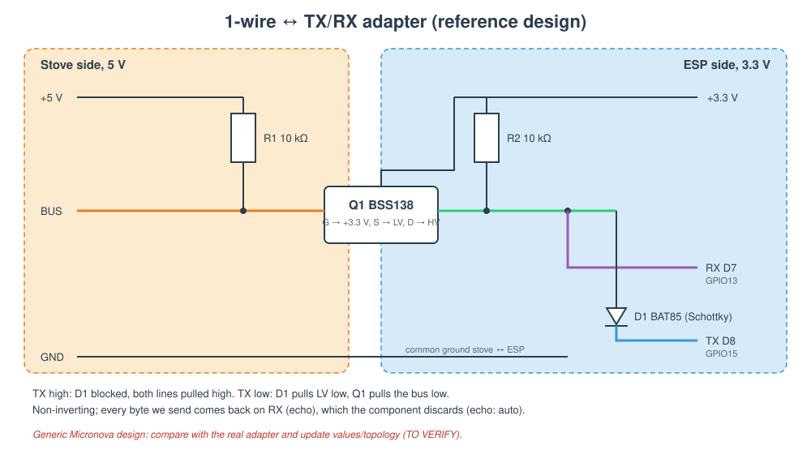

# 1-wire adapter

[← README](../README.md) · [hardware](hardware.md) · [protocol](protocol.md)

The stove's Micronova bus is a **single wire** that carries both directions at 5 V
([protocol.md §1](protocol.md#1-physical-layer)). The ESP8266 has a separate TX and RX at 3.3 V and is
**not 5 V tolerant** in a documented, reliable way. The adapter bridges the two:

- it **splits** the bidirectional bus into an ESP TX input and an ESP RX output;
- it **shifts levels** between 5 V (stove) and 3.3 V (ESP);
- it keeps the bus **open-drain**: nobody drives it high, so the display panel and the ESP can share it.

> **Status.** The topology below is the common, non-inverting design used for Micronova boards. It matches what
> the 2020 code expects (no UART inversion, own frames echoed on RX), but it has **not yet been checked against
> the physical adapter**. Fill in §4 from the real board and fix the figure if anything differs.

The owner's retained drawing instead shows **a diode, a 10 kΩ resistor and an
NPN transistor**. It is not Figure 1's BSS138 circuit. The as-built HAT contact
positions, transistor part/pin order, receive biasing and power connections have
not been established. Do not substitute this reference circuit for the actual
board when deciding how to insert the ESP.

## 1. Reference circuit

**Figure 1**: 1-wire ↔ TX/RX adapter. A BSS138 level shifter joins the 5 V bus to a 3.3 V line; ESP RX reads that
line directly and ESP TX can only pull it low, through a Schottky diode. Both sides are pulled up, nobody drives high.

| Ref | Part | Role |
|---|---|---|
| Q1 | BSS138 N-MOSFET (or any bidirectional I²C level-shifter module) | 5 V ↔ 3.3 V open-drain shifting |
| R1 | 10 kΩ to +5 V | bus pull-up, stove side (may already exist on the stove board: TO VERIFY) |
| R2 | 10 kΩ to +3.3 V | pull-up, ESP side |
| D1 | BAT85 / 1N5817 Schottky, cathode to ESP TX | lets TX pull the line low, never push it high |

## 2. How it works

| ESP TX | D1 | 3.3 V line | Bus | ESP RX sees |
|---|---|---|---|---|
| idle (high) | blocked | high (R2) | high (R1) | stove/panel traffic |
| low (start bit, `0` bits) | conducts | low | pulled low by Q1 | our own bits (echo) |
| high, stove pulls bus low | blocked | pulled low by Q1 body diode/channel | low | stove reply |

Consequences for the firmware:

- **Echo**: every byte sent comes back on RX. The component reads and discards it (`echo: auto` detects it on the
  first frame; force with `echo: true/false`).
- **No inversion**: the UART is used as-is (`uart:` without `inverted`).
- **Collisions** with the panel are possible: the component retries (`max_retries`) and counts them (`info`).

## 3. Alternatives

| Variant | Notes |
|---|---|
| NPN transistor on TX + resistor divider on RX | simple, but the transistor **inverts** TX: use `tx_pin: {number: GPIO15, inverted: true}` |
| Optocouplers (e.g. 2× PC817) | galvanic isolation from the stove; slower edges, fine at 1200 baud |
| Diode + divider only | works when the stove pull-up is weak; check the low level reaches < 0.8 V |

## 4. As built (TO FILL)

| Item | Value |
|---|---|
| Topology | TO VERIFY (photo + schematic in the private repo `hardware/adapter/`) |
| Parts and values | TO VERIFY |
| Stove-side pull-up present on the board? | TO VERIFY (measure bus idle voltage with the adapter disconnected) |
| Power source | USB-powered devkit preferred; stove supply pin and current budget unverified |
| Measured levels | bus idle __ V, bus low __ V, ESP RX low __ V |

Measurement procedure:

1. Verify the adapter on an isolated bench supply first, including its behaviour while the ESP is
   unpowered: avoid back-powering GPIOs and check RX never exceeds 3.3 V.
2. Before any stove connection, follow the [connector/isolation precautions](hardware.md#4-stove-connector-to-verify).
   Live measurements inside the stove need a qualified technician and appropriately isolated equipment;
   a grounded scope/USB lead can introduce a dangerous ground path.
3. With connector pinout and isolation established, verify idle/low levels against documented signal ground
   and observe 1200 baud, 8N2 traffic. Power down before changing connections.
4. With the checked adapter connected, `plz inspect ram 0xF9` should return a checksum-valid
   `0x1A` when this Lara is off. A matching value alone does not validate the electrical installation.

[← hardware](hardware.md) · [protocol →](protocol.md)
