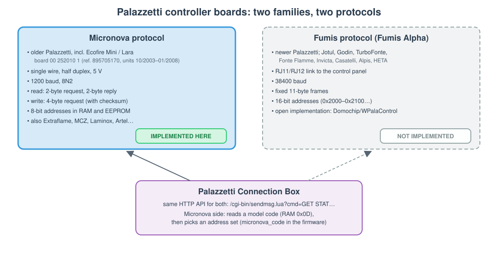

# Controller boards: Micronova and Fumis

[← README](../README.md) · [hardware](hardware.md) · [protocol](protocol.md) · [connection box](connection-box.md) · [references](references.md)

Palazzetti has used two families of controller board, and they do not speak the same serial protocol. This page
says which one the Ecofire Lara has, which one this repository implements, and how to tell them apart on another
stove. In short: **the Ecofire Lara speaks the Micronova protocol, and that is the only protocol implemented
here.**

## 1. Two families

**Figure 1**: The two board families behind Palazzetti stoves. The component and the `plz` tool implement the
Micronova protocol (left). Fumis boards (right) use a different link, speed, frame and address space. The
Connection Box hides the difference behind one HTTP API.

| | **Micronova protocol** | **Fumis protocol** |
|---|---|---|
| Palazzetti stoves | older models, including the **Ecofire Mini / Lara** | newer models (cut-over date unknown) |
| Other brands | Extraflame, MCZ, Laminox, Artel, Ungaro, L'Asolana… | Jotul, Godin, TurboFonte, Fonte Flamme, Invicta, Casatelli, Alpis, HETA |
| Link | single wire, half duplex, 5 V | RJ11/RJ12 to the control panel |
| Speed, framing | 1200 baud, 8N2 | 38400 baud |
| Frames | read: 2 bytes out, 2 back; write: 4 bytes out ([protocol.md](protocol.md#2-frames)) | fixed 11-byte frames |
| Addresses | 8 bits used (0x00–0xFF) in two memories, RAM and EEPROM | 16 bits, one space (`0x2000`–`0x2100`…, e.g. status at `0x201C`, serial number from `0x2100`) |
| Memory maps | per board, see [memory-map.md](memory-map.md) | fixed per firmware, see Domochip's library |
| Connection Box | supported (Micronova code path, model code at RAM 0x0D) | supported |
| Open projects | ESPHome `micronova`, philibertc, eni23… | Domochip/WPalaControl, Domochip/Palazzetti |
| **This repository** | **implemented** | **not implemented** |

"Micronova" here names the protocol. Whether the Lara board is made by Micronova or by Palazzetti using
Micronova's protocol is not known yet (see §2); the protocol is what matters to the code.

The Fumis column comes from [Domochip/Palazzetti](https://github.com/Domochip/Palazzetti), the serial layer of the
Connection Box rewritten from its firmware, and [Domochip/WPalaControl](https://github.com/Domochip/WPalaControl).
We have not checked it on a Fumis stove.

## 2. The Ecofire Lara board

| Evidence | What it shows | Source |
|---|---|---|
| Spare-part listing: *Ecofire Mini digital board (00 252010 1)*, Palazzetti ref. 895705170, "for units dated 10/2003 to 01/2008", plus its *microchip* (002520101, ref. 895705120) | the board fitted to the Ecofire Mini / Lara of that period; the microchip is the programmed controller, sold separately | [palazzetti-ecofire-lara](https://github.com/jordanauge/palazzetti-ecofire-lara) `spare-parts/README.md`, positions 97–98 and 114 |
| 2020 capture: 46.9 h of sequential scans of all 256 RAM addresses, sent as 2-byte Micronova requests at 1200 8N2; accepted replies and failed reads must be distinguished (legacy checksum caveats apply) | the board answers the Micronova protocol; this does not mean every read succeeded | private repo `dumps/2020-02-10-ram/`, [reverse-engineering.md](reverse-engineering.md) |
| The state register (RAM 0xF9) follows ignition, working and cleaning phases in that capture | the replies are live stove data, not noise | [memory-map.md](memory-map.md) |
| RAM 0x0D is constant 232 | likely the model code the Connection Box reads on its Micronova path | [connection-box.md](connection-box.md) |

Still **to verify**:

- the board's own markings and photos (private repo `notes/hardware/`): maker, model, firmware version;
- whether the display panel matches the Micronova *I023 LCD Aria* manual kept in the reference repo `resources/manuals/micronova/`;
- the connector pinout (see [hardware.md § stove connector](hardware.md#4-stove-connector-to-verify)).

A Lara built after 01/2008 may have a different board. Check it with §4 before relying on these maps.

## 3. What this repository implements

Everything in the code targets the **Micronova protocol**:

- [micronova.h](../components/palazzetti/micronova.h) builds and checks the frames. The component's
  configuration check rejects any UART other than 1200 baud with 2 stop bits.
- [codec.py](../tools/plz/codec.py) is the same codec for the `plz` tool and the emulator.
- The [maps](../maps) are Micronova RAM/EEPROM layouts: generic ones and the Ecofire Lara profile.
- The [adapter](adapter.md) and [hardware](hardware.md) pages describe the Micronova single-wire bus.

**Fumis is not implemented.** Supporting it would need a separate frame layer: 38400 baud, 11-byte frames and
16-bit addresses. It would also need its own maps and the RJ11/RJ12 wiring, and someone with a Fumis stove to
test it. Until then, for a Fumis stove use [WPalaControl](https://github.com/Domochip/WPalaControl), or the
Connection Box with the Home Assistant `palazzetti` integration.

The **Connection Box** is a layer above both families. [connection-box.md](connection-box.md) and the
`palazzetti-connbox` profile cover its Micronova side only.

## 4. Which board does my stove have?

1. **Look at the board and the panel.** A Micronova board label, or the board reference above, points to
   Micronova. An RJ11/RJ12 socket to the panel and the controller photos in WPalaControl's README point to Fumis.
2. **Probe it read-only.** Wire the device as in [hardware.md](hardware.md) and run `plz read ram 0xF9`, then
   `plz dump ram:0-0x20`. Valid replies mean a Micronova bus. If every read times out, first check the wiring and
   the echo setting; a stove that never answers may be a Fumis board.
3. **Ask the Connection Box**, if there is one: `GET MDVE` returns the model and firmware version. Note them in
   the private repo with the board photos.

Probing only reads memory. Never send write frames to a stove whose board family is not established
([reverse-engineering.md § safety](reverse-engineering.md#6-safety-rules)).

[← README](../README.md) · [protocol →](protocol.md)
