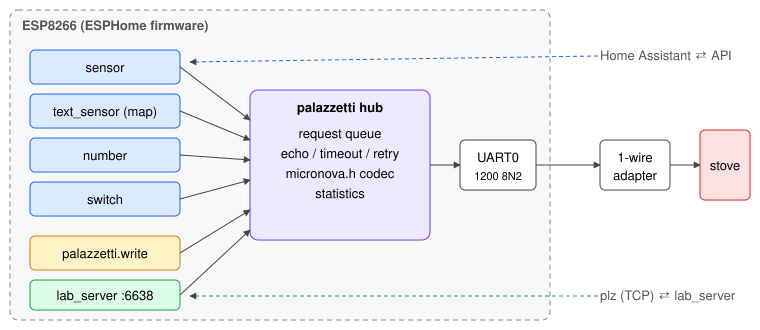

# ESPHome component

[← README](../README.md) · [hardware](hardware.md) · [memory map](memory-map.md) · [reverse engineering](reverse-engineering.md)

`components/palazzetti` is an ESPHome external component that speaks the [Micronova protocol](protocol.md). It is
built like any ESPHome firmware: ESPHome generates a PlatformIO project and PlatformIO fetches the ESP8266
toolchain and framework, so no separate Espressif toolchain is needed.

## 1. Architecture



**Figure 1**: One `palazzetti` hub owns the UART and a request queue. Entities (sensor, text sensor, number,
switch) and the `palazzetti.write` action enqueue reads/writes; the optional lab server shares the same queue, so
interactive commands from `plz` never collide with entity polling.

| File | Role |
|---|---|
| [micronova.h](../components/palazzetti/micronova.h) | frame building and reply checks, pure C++ (host-tested) |
| [write_policy.h](../components/palazzetti/write_policy.h) | central address/value allowlist and volatile RAM/EEPROM permission gates |
| [polling_plan.h](../components/palazzetti/polling_plan.h) | bounded volatile range scheduler; shared hub keeps checked plan results |
| [palazzetti.h](../components/palazzetti/palazzetti.h), [palazzetti.cpp](../components/palazzetti/palazzetti.cpp) | hub: queue, UART state machine, echo handling, retries, statistics |
| [bus_entity.h](../components/palazzetti/bus_entity.h), [bus_entity.cpp](../components/palazzetti/bus_entity.cpp) | sensor / text sensor / number / switch bound to one address |
| [lab_server.h](../components/palazzetti/lab_server.h), [lab_server.cpp](../components/palazzetti/lab_server.cpp) | TCP line protocol for the [lab tool](reverse-engineering.md) |
| `__init__.py`, `sensor.py`, `text_sensor.py`, `number.py`, `switch.py` | configuration schema and code generation |

## 2. Build

```bash
uv tool install esphome             # brings PlatformIO; no separate ESP toolchain
uv sync                            # lab tool and tests
cp example/secrets.yaml.example example/secrets.yaml   # only if no secrets file exists
make config                         # validate configuration after editing secrets
make build                          # esphome compile example/palazzetti-ecofire-lara.yaml
make upload DEVICE=/dev/cu.usbserial-xxxx   # first flash over USB; later: DEVICE=palazzetti.local
make logs
```

Use a USB data cable and select the actual serial device path for the first upload.
Disconnect the stove and adapter during flashing. Fill **all** entries in
[secrets.yaml.example](../example/secrets.yaml.example), including API encryption, OTA,
fallback AP and web credentials; use unique passwords. Do not overwrite an existing secrets file.
The default board is `nodemcuv2`, the PlatformIO definition used for NodeMCU V3 ESP-12F.
After connecting to Wi-Fi, use `make upload DEVICE=palazzetti.local` for OTA and
`make logs DEVICE=palazzetti.local` for logs. Runtime logs are not on the USB UART.
No upload is needed to inspect build output; compilation does not touch the stove.

Other targets: `make test` (Python + host C++ tests), `make test-compile` (every platform/option), `make gen`
(regenerate the memory map doc and entity packages from `maps/`).

If PlatformIO fails to download a package (e.g. TLS errors on a registry mirror), it retries other mirrors. A
package can also be installed from a local archive (`pio pkg install -g -t file:///path/pkg.tar.gz`); then make sure
its `.piopm` carries `"owner": "platformio"` so that ESPHome's `platformio/<name>` requirement matches it.

## 3. Configuration

The example is split in three packages:

- [palazzetti-base.yaml](../example/palazzetti-base.yaml): board, Wi-Fi, API, UART, hub, lab server;
- [palazzetti-ecofire-lara.entities.yaml](../example/palazzetti-ecofire-lara.entities.yaml): one entity per known
  address, **generated** from [maps/palazzetti-ecofire-lara.yaml](../maps/palazzetti-ecofire-lara.yaml)
  (`plz gen-esphome`). Hypotheses are created `disabled_by_default`.
- [palazzetti-web.yaml](../example/palazzetti-web.yaml): native ESPHome web server, diagnostic entities,
  network time, permission switches and encrypted native-API read action. Remove this package to omit the dashboard.

[palazzetti-ecofire-lara.yaml](../example/palazzetti-ecofire-lara.yaml) includes all three. For another stove, add a
profile in `maps/` and generate its package.

### 3.1 Hub

```yaml
uart:
  id: stove_uart
  tx_pin: GPIO15
  rx_pin: GPIO13
  baud_rate: 1200
  stop_bits: 2

palazzetti:
  id: stove
  uart_id: stove_uart
  echo: auto            # auto | true | false: own frames echoed on RX (1-wire adapter)
  reply_timeout: 300ms
  frame_gap: 30ms
  max_retries: 2
  max_queue: 48
  lab_server:           # optional, see reverse-engineering.md
    port: 6638
    allow_write: false  # additional compile-time permission for lab w; raw writes never allowed
  write_allowlist: []   # generated from separately confirmed write evidence; Lara currently empty
```

### 3.2 Entities

All platforms share `palazzetti_id`, `memory` (`ram` default, or `eeprom`), `address` (0x0000–0x1FFF), `encoding`
(`uint8`, `int8`, `bcd`, `uint16_be`, `uint16_le`, `int16_be`, `int16_le`) and `update_interval`.

```yaml
sensor:
  - platform: palazzetti
    name: Fumes temperature
    address: 0x42
    unit_of_measurement: °C
    update_interval: 30s

text_sensor:
  - platform: palazzetti
    name: Power state
    address: 0xF9
    map: {0x1A: "off", 0x2B: ignition, 0x4B: working, 0x1D: final cleaning}

```

`number` and `switch` platforms remain available for a controller with verified write semantics;
`number` uses `displayed = raw * multiply + offset`, with positive `multiply`.
Every write, including custom entities and automations, must pass the hub policy.
Multi-byte entity writes are refused because sequential bus transactions are not atomic.
The switch defaults to `restore_mode: DISABLED`: it never restores a stove write at boot.
The Lara package generates read-only sensors for its observed settings. Nested chrono bytes
are hypotheses, marked `(?)`, with 300-second polling. `disabled_by_default` hides an entity
initially in Home Assistant but does **not** stop polling; remove unwanted entities or use lab `pause`.

### 3.3 Action

The `palazzetti.write` action accepts `id`, `memory`, `address` and a templatable byte `value`.
It does not bypass the policy. Do not add Lara power or schedule actions until command evidence is established.

### 3.4 Web dashboard and write mode

Browse `http://palazzetti.local/` (or its IP), using your web credentials. The native ESPHome
dashboard displays stove state, temperatures, power/fan settings, stove clock bytes, chrono
bytes and bus diagnostics. The SNTP **Network clock** is separate from the stove clock;
it does not synchronize or write stove time. Unknown schedule encodings are not a working scheduler.
The standard ESPHome v3 frontend loads assets from ESPHome's CDN and needs browser Internet access.

**Stove write mode** and **EEPROM write permission** both start off and are not restored.
Turning the general mode off revokes EEPROM permission and cancels pending writes at dispatch.
It cannot undo an already transmitted command. EEPROM permission also requires general mode.
Neither switch grants arbitrary memory access: address, memory and byte value must match a
confirmed rule. The current Lara rule count is **zero**, so toggling either mode cannot write
stove settings. EEPROM writes persist and need stronger evidence than RAM observations.

The web server uses Basic authentication over HTTP, not TLS. Use a trusted isolated LAN;
do not forward its port or the unauthenticated TCP lab port to the Internet.

### 3.5 Native API read action

Home Assistant exposes `read_memory` through the encrypted ESPHome API. Its integer arguments
are `memory` (0 RAM, 1 EEPROM) and `address` (0..8191). The action queues a checked read
and publishes **Last API memory read**, including validity, reply length, checksum result,
attempt count and final-attempt latency. Invalid arguments and full queues publish errors.
For machine-readable complete byte evidence and session logging, use `plz inspect`;
this text entity only retains the latest action result.

### 3.6 Autonomous polling

The hub has a volatile 32-range read plan, stopped/empty at boot, plus a bounded
32-result drain buffer. The lab API and native actions edit it without reflashing.
It continues between client connections but never writes to the stove or ESP flash.
See [acquisition.md](acquisition.md) for periods, fairness, runtime capacity,
gap/reboot handling, CLI recording and repeated baseline backups.

## 4. Tests

- `tests/test_micronova.cpp`: host test of the codec (`make test-cpp`).
- `tests/test_*.py`: codec mirror, maps, sessions/analysis, emulator ↔ client round trip (`make test-py`).
- `tests/compile-esp8266.yaml`: compiles every platform and the action (`make test-compile`).

[← README](../README.md) · [reverse engineering →](reverse-engineering.md)
