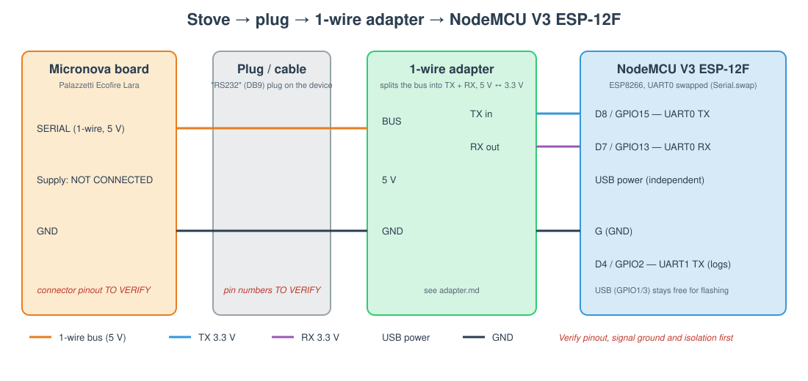
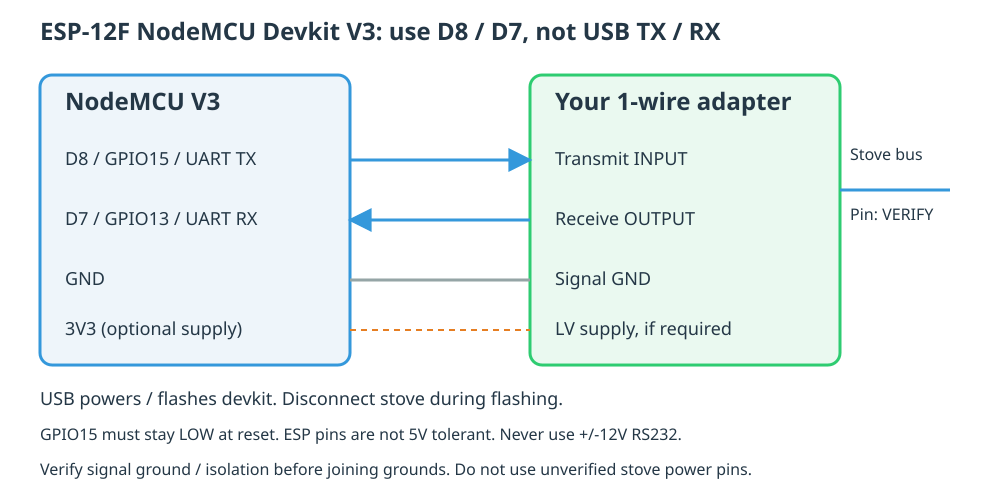

# Hardware

[← README](../README.md) · [adapter](adapter.md) · [protocol](protocol.md) · [esphome](esphome.md)

This page describes how to wire an ESP8266 board to the stove through the [1-wire adapter](adapter.md) and the
device's "RS232" plug, and how to flash it. Items marked **TO VERIFY** have not been measured on the Ecofire Lara
yet; check them before connecting anything to the stove.

## 1. Overview



**Figure 1**: Signal chain. The stove's Micronova board exposes a 5 V single-wire serial bus. A cable ends in the
device's DB9 ("RS232") plug; the adapter splits the bus into TX/RX at 3.3 V for the ESP8266's UART0 on its
alternate pins. Logs go out on UART1 so that UART0 is dedicated to the stove.

This applies to stoves with a Micronova-protocol board, such as the Ecofire Lara. Fumis boards use a different
link; see [boards.md](boards.md).

The "RS232" plug only refers to the **connector**. The signal on it is **not** RS232 (±12 V); it is the stove's 5 V
single-wire bus. Never plug it into a real RS232 port or a USB-RS232 converter.

## 2. Bill of materials

| Item | Notes |
|---|---|
| NodeMCU Devkit V3, ESP-12F (ESP8266, 4 MB) | default `board: nodemcuv2` in [base package](../example/palazzetti-base.yaml); this PlatformIO ID also covers V3 |
| 1-wire adapter | see [adapter.md](adapter.md) |
| DB9 plug + cable to the stove's serial connector | pinout TO VERIFY (§4) |
| USB cable / USB supply | power the devkit independently; stove supply pin and current budget are unverified |

## 3. ESP8266 pinout

The ESP8266 has one full UART (UART0) and a TX-only UART1. UART0 is mapped to the USB serial chip on GPIO1/GPIO3;
`Serial.swap()` (done by ESPHome when it sees `tx_pin: GPIO15`, `rx_pin: GPIO13`) moves it to GPIO15/GPIO13. That
keeps USB usable for flashing and gives the stove a real hardware UART (8N2 at 1200 baud is not reliable with a
software serial).

| NodeMCU V3 label | GPIO | Use | Constraint |
|---|---|---|---|
| D8 | GPIO15 | **UART0 TX** → adapter transmit input | boot strap: **must be low at boot**. Keep the devkit pull-down; verify the actual adapter does not pull it high. |
| D7 | GPIO13 | **UART0 RX** ← adapter RX out | none |
| D4 | GPIO2 | UART1 TX: ESPHome logs (`logger: hardware_uart: UART1`) | boot strap: must be high at boot; on-board LED |
| VIN / VU (board-dependent) | – | do not use for this USB-powered setup | labels and power paths vary across clones |
| G / GND | – | ground, common with the verified stove signal ground | not automatically chassis/earth |
| 3V3 | – | adapter low-voltage supply, **only if its circuit requires it** | never apply stove 5 V to this pin or an ESP GPIO |
| TX/RX | GPIO1/3 | USB serial (flashing, not used at runtime) | |

Reading logs: `esphome logs` over Wi-Fi (API), or a USB-TTL adapter on D4 at 115200 baud.

### Minimal connection to your existing adapter



**Figure 2**: Follow signal direction, not ambiguous TX/RX labels on an adapter:
ESP **D8 sends** into its transmit input, and **D7 receives** from its receive output.
The USB UART pins marked TX/RX are **not** the stove pins.
The adapter must provide non-inverted 3.3 V-compatible UART signals; its as-built circuit still needs verification.

### HAT insertion direction is not established

The retained original Arduino firmware explicitly calls
`Serial.swap(); // RX = D7, TX=D8` after configuring 1200 baud 8N2.
The ESPHome D7/D8 assignments therefore preserve the original implementation,
not a new proposed rewiring.

GPIO assignments describe **signals**, not the physical orientation of a custom
socket. Do not infer direction from the green wire, USB end, diode position or
another adapter's diagram. The owner's saved diode/resistor/NPN drawing differs
from the reference MOSFET circuit in [adapter.md](adapter.md).

With **USB, stove cable and every other supply disconnected**, establish which
HAT socket contacts connect to its signal ground, supply, transmit input and
receive output. Match those contacts to the exact devkit's printed **GND, 3V3,
D8 and D7** labels. Check the entire socket, not just the UART pair: inserting a
board backwards can connect supply voltage to GPIOs.
Unpowered continuity checks identify wiring, not the suitability of a voltage
or isolation arrangement. If a socket contact is tied to the stove's supply,
do not insert or USB-power the ESP until that supply path is verified.

A D1 mini can use the same D8/D7 GPIO mapping with `board: d1_mini`.
GPIO1/3 are another hardware UART0 mapping, but share USB serial and are not used here.
ESP32 ports require adapting the board/UART configuration; they have not been validated by this build.

## 4. Stove connector (TO VERIFY)

| Signal | Stove connector pin | DB9 pin on the device | Notes |
|---|---|---|---|
| Serial (bus) | TO VERIFY | TO VERIFY | 5 V idle, pulled low by talkers |
| +5 V | TO VERIFY | TO VERIFY | available on most Micronova boards; current budget unknown |
| GND | TO VERIFY | TO VERIFY | |
| other (+20 V on some Micronova boards) | TO VERIFY | not connected | **never connect to the ESP** |

How to fill this table safely:

1. Disconnect mains before any continuity measurements. Do **not** assume chassis/earth is signal ground.
   Identify the connector from reliable controller documentation; live measurements inside the stove require
   a qualified technician and suitably isolated equipment.
2. Verify voltage levels and isolation relative to the documented signal ground before attaching the ESP or USB.
   A pin's idle voltage alone does not distinguish a supply from a pulled-up bus.
3. Observe the candidate bus with appropriate isolated equipment: expected framing is 1200 baud, 8N2.
4. Record verified pins and photos privately. Until then, leave the stove connector and its power pins disconnected.

## 5. Assembly and first test

1. Build the adapter and check it on the bench with a 5 V supply and a 10 kΩ pull-up as "stove" (no ESP-side
   voltage above 3.3 V, bus pulled low when ESP TX is low).
2. Flash the firmware over USB with the stove **disconnected** ([esphome.md](esphome.md)).
3. Only after the connector and safe common-ground arrangement are verified, connect with power removed.
   Keep the stove supply unused; power the devkit by USB. Never hot-wire an energized stove connector.
4. Check from a computer on the same network:
   ```
   plz --host palazzetti.local info
   plz --host palazzetti.local read ram 0xF9     # 0x1A when the stove is off
   ```
5. Watch `ok`/`timeout`/`bad` counters in `plz info`: a few timeouts are normal (bus shared with the panel);
   only timeouts means a wiring or level problem; only bad checksums means echo or framing problems
   (try `echo: true`/`false`, check 2 stop bits).

[← README](../README.md) · [adapter →](adapter.md)
