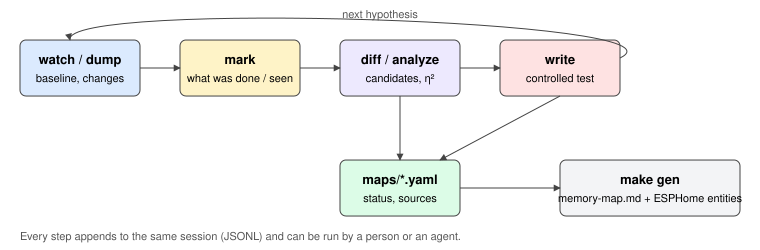

# Reverse engineering workflow

[← README](../README.md) · [esphome](esphome.md) · [protocol](protocol.md) · [memory map](memory-map.md)

The goal is a complete RAM and EEPROM map for each stove. Many addresses are undocumented, so the method is
empirical: observe values over time, annotate what happens to the stove, correlate, then test hypotheses with
controlled writes. The `plz` tool ([tools/plz](../tools/plz)) does this through the device's lab server. Every
command is a one-shot, non-interactive CLI call, so a person or an AI agent can drive a session.

For baseline preservation and targeted live investigations, start with
[repeated backups and autonomous polling](acquisition.md). Plans can be edited
without reflashing and read only selected bytes/ranges at independent periods.

## 1. Setup

1. Flash the device with `lab_server` enabled (default in [palazzetti-base.yaml](../example/palazzetti-base.yaml)).
   Leave `lab_allow_write: "false"` for read campaigns. Reads need no write permissions.
2. Install the tool: `uv sync` in this repo, then `uv run plz …` (or `make` targets).
3. Choose a session. All results (scans, changes, marks, writes) are appended to one JSONL file:

```bash
export PLZ_HOST=palazzetti.local                # or the IP
export PLZ_SESSIONS=../palazzetti-connection-box-reverse/sessions   # keep raw data out of the public repo
export PLZ_SESSION=2025-01-lara-fan-tests
uv run plz info                                 # bus statistics, checks the link
```

Sessions can be compressed (`.jsonl.xz`); every analysis command reads them directly.

## 2. Loop



**Figure 1**: The loop. Watching gives a baseline. Marks place the observer's knowledge (what was done, what the
stove shows) on the same timeline. `diff` and `analyze` turn this into candidate meanings, and controlled writes
confirm them. Confirmed facts go into `maps/`, which generates both the docs and the firmware entities.

| Step | Command | Notes |
|---|---|---|
| snapshot | `plz dump ram:0-0xFF eeprom:0-0x7F` | full image into the session |
| watch | `plz watch ram:0-0xFF -i 20 -x ram:0x0B-0x2F` | prints only changes; `-x` hides known-noisy ranges; `-d 600` stops after 10 min |
| passive | `plz monitor` | logs what the entities poll, without extra bus load |
| annotate | `plz mark "set fan 2 → 4 on the panel"` | do it **right after** the action, with what the panel shows |
| compare | `plz diff "fan 2" "fan 4" -a 60 -p palazzetti-ecofire-lara` | values changed between two marks (or unix times, `start`, `end`), labelled from the map |
| report | `plz analyze --state ram:0xF9 -p palazzetti-ecofire-lara -o report.md` | per-address stats, correlation with the state register (η²), changes after each mark |
| inspect | `plz inspect ram 0xF9` | JSON checked reply, transmitted bytes, validity, attempts, latency; logs evidence |
| raw read | `plz raw 00F9 2`, `plz send "pause"` | checked two-byte read only; raw write frames refused |

Run `watch` in one terminal (or background job) and the other commands next to it. They all append to the same
session.

## 3. Driving it from an agent

An agent with shell access can run a whole campaign:

1. Start `plz watch … -d 0` in the background.
2. Ask the user for an action ("raise the power level to 4 on the remote"). After it is done, run `plz mark` with
   the description.
3. Run `plz diff` around the mark and propose candidates.
4. Keep the campaign read-only. Use physical panel changes to test hypotheses; a likely
   meaning is **not** permission to write. User-approved write tests require separately
   verified commands, bounds, an allowlist and both relevant runtime permissions.
5. Update `maps/<profile>.yaml` (`status` and `sources`), then run `make gen` and `make test`.

The user can also describe things the stove does by itself (the alarm beeps, the fan is louder, the flame goes
out). The agent marks each one and looks for what moved.

## 4. Analysis

`analyze` computes, for each address:

- min/max, the number of distinct values, the most frequent values;
- **η² (correlation ratio)** against the state register: 1.0 means the value is fully determined by the stove
  state. Examples on the Lara: 0xFA, 0x09, 0x5A, 0x3B, 0x4E, 0x6C;
- the timeline of the state register;
- the values that changed within `-w` seconds after each mark.

Example: the 2020 Lara capture (47 h, 13 839 scans, 4 on/off cycles). Its conclusions are in
[maps/palazzetti-ecofire-lara.yaml](../maps/palazzetti-ecofire-lara.yaml). The full report stays in the private repo,
under `dumps/2020-02-10-ram/ANALYSIS.md`.

Older Arduino captures can be imported with `plz import-legacy dump.txt.xz`. The importer handles the legacy
checksum bug (see [protocol](protocol.md#21-checksum-caveats)).

## 5. First EEPROM campaign: locate the service parameters

No EEPROM image of the Lara exists yet. The service menu values recorded in the
[palazzetti-ecofire-lara](https://github.com/jordanauge/palazzetti-ecofire-lara) repo (`settings/manu-sav.md`)
are known values that should appear in it. Examples:

| Service value | Likely raw byte |
|---|---|
| `DOFF COC P1..P4` = 6.8 / 3.5 / 2.0 / 1.2 s | 68, 35, 20, 12 (×0.1 s) consecutive |
| `G FUMI P1..P4` = 1600 / 1800 / 2500 / 2600 rpm | 160, 180, 250, 260? (×10, 260 overflows: maybe ×20 or 16-bit) |
| `V.SCAMB.1..4` = 1 / 2 / 4 / 5 | 1, 2, 4, 5 consecutive |
| `ST.SCAMB.MX` = 140 °C, `T.ALL.PELL.` = 80 °C | 140, 80 |

1. `plz dump eeprom:0-0x1FF` with the stove off. Repeat it to check stability.
2. Search the image for those sequences.
3. Change one value in the service menu (and note the old one), `plz mark`, dump again, then `plz diff`.
4. Restore the value. Record the address as `observed` in the Lara profile.

## 6. Safety rules

- Read-only by default. Lab writes need `lab_allow_write: "true"`, an explicit `plz write`,
  runtime **Stove write mode**, and a matching confirmed address/value rule.
  EEPROM additionally needs **EEPROM write permission**. All entity/action writes share
  the same central policy; compile-time lab permission alone authorizes nothing.
- Raw commands now accept **only checked two-byte Micronova reads**, even with write mode on.
  This intentionally removes the old arbitrary-frame write bypass.
- Never write while the stove is in ignition or final cleaning. Never write to unknown EEPROM addresses: EEPROM
  holds the factory parameters (pellet feed timing, fan curves, safety thresholds). A wrong value can make the
  stove unsafe or brick its configuration.
- Before an EEPROM campaign, dump the full EEPROM and keep it with the session so that it can be restored.
- Generic Micronova on/off writes (RAM 0x21) are **not** valid on the Lara. Use only addresses confirmed in the
  profile.
- `pause` stops entity and plan scheduling while a lab connection is held. Default framing/gap
  limits successful acquisition to roughly 15 reads/s before contention/retries.

## 7. Offline work

`plz emulate --seed SESSION` starts a fake lab server whose memory is the last image of a session. Use it to
develop analyses or test an agent without the stove:

```bash
uv run plz --port 6638 emulate --listen 127.0.0.1 --seed 2020-02-10-legacy-ram --read-only &
PLZ_HOST=127.0.0.1 uv run plz dump ram:0-0xFF
```

`--fail-rate` injects bus errors to test retries.

## 8. Promoting knowledge

`maps/*.yaml` is the single source of truth:

- `status`: `unknown` → `hypothesis` → `observed` → `confirmed` (read and write behaviour verified). Two more
  values: `reported` (from a third-party source, not checked here) and `refuted` (a generic meaning that this
  stove does not follow). Read certainty is not write authorization;
- `write_status`: defaults to `unverified`; `confirmed` additionally requires `access: rw`,
  observed/confirmed read semantics, `write_sources` and exact `raw_min`/`raw_max` byte bounds.
  Automatic write generation currently supports only `uint8`, not multi-byte or BCD fields.
  Enumerated fields allow only listed values within those bounds;
- `sources`: keys of the profile's `sources` (notes, captures, manuals);
- `evidence`: claim-specific source, origin, method and scope; see
  [map schema](../maps/README.md#claim-specific-provenance). Credit a reference separately
  for a reported address, encoding, layout or insight. Do not make a representation
  hint into Lara address evidence;
- [Reference extractions](reference-mappings/README.md) retain other-board layouts and
  software findings outside `maps/`. They are not maintained or selectable stove maps.
  Promote only Lara-specific address evidence to its map; credit representation hints
  separately. See [maps/README.md](../maps/README.md).

`make gen` regenerates [memory-map.md](memory-map.md) and the ESPHome entity packages. Hypotheses are generated
disabled by default.

### Locating the service settings

The Lara profile has an **unlocated inventory** of all 35 historical service labels,
plus unresolved display-text and chrono-enable targets. This is a completion checklist,
not an EEPROM map. Known user settings remain in `fields`; unidentified targets remain
in `unlocated` until a justified address hypothesis can be recorded.
Other-model documents can supply additional **conditional** targets, but a hydro-water,
pump, pressure or Fumis-specific parameter need not exist on this air stove.
Even a corresponding setting may be computed, split, packed, stored outside accessible
EEPROM or represented by an index. Absence of a match is not proof of absence.

Use the following evidence chain before promoting a candidate:

1. Identify stove, board, firmware, menu path and units. Keep dated actual values,
   manufacturer defaults and model-specific allowed ranges separate.
2. Take repeated checked EEPROM backups and timestamped RAM observations using
   [acquisition](acquisition.md). No independently checked Lara EEPROM backup has
   yet been supplied; a complete map cannot be claimed.
3. Test **explicit** representations suggested by sources: plain/scaled integers,
   model bias, signed adjustment, BCD, ten-minute schedule units, bit fields or
   multi-byte endianness. Record the source for each suggestion. Avoid arbitrary
   conversions chosen merely to make one number match.
4. Match multiple distinct paired panel readings if safe observations exist.
   Duplicate zeros, common values and a single default/range match produce many
   candidates; retain them all with their ambiguity.
5. Check variation and nearby bytes. Ordered P1–P4 groups or service-menu order can
   strengthen a candidate structure, but adjacency alone does not identify it.
   RAM mirrors and sequential sampling can differ from stored settings.
6. Prefer passive normal-use observations. Do not change combustion/safety settings,
   reset defaults or run output tests merely to identify bytes. Any user-approved
   physical-menu change must be dated and labelled `panel_change`, not serial write
   evidence.
7. Record counterevidence, missing support and alternate interpretations per byte.
   Promote reading semantics only when supported; safe writes require their own
   independent policy evidence.

The constant RAM block `23–2F` has a **tentative adjacency clue** against the tail
of the historical service settings. It is not an assigned service structure and
provides no EEPROM offset. This is the kind of clue to preserve without upgrading
certainty.

## 9. Read evidence API and Lara on/off investigation

`plz inspect ram 0xF9` uses the lab line `i ram 0xF9`. The JSON result has `mem`, `addr`,
`valid`, `value`, `check`, `tx`, `rx`, `attempts` and `elapsed_ms`. Invalid values are
**null**, not zero or `FF`; failed reads are logged as `read_failed` and excluded from
value evolution. `rx` retains received bytes after echo handling, including partial/bad
replies. Only the final retry's bytes and latency are retained; this is not total
queue wait or all-attempt timing. `info` adds `write`, `eeprom` and `rules` to bus counters.
Existing `read`, `dump`, `watch` and `monitor` commands remain available.

There is **no verified Lara on/off command yet**. RAM `F9` reads the state
(`1A` off, `2B` ignition, `4B` working, `1D` final cleaning); it is not a proven
command register. The generic Micronova `21` write recipe is refuted for this Lara.
EEPROM `76..78` contains observed user settings, but safe write commands are not established.
The tentative chrono region overlaps `76`; do not turn that hypothesis into schedule writes.

To investigate without sending control commands, record a baseline, then observe a normal,
user-supervised physical-panel start or stop and mark it immediately. Scan/inspect RAM and
compare surrounding values with `F9`. Do not provoke repeated ignition cycles just for data.
Correlations reveal candidate state fields, not commands. Establish the real command through
controller documentation or a safely captured known controller transaction before adding
write evidence. The dashboard therefore deliberately has **no Lara on/off button**.

[← esphome](esphome.md) · [connection box →](connection-box.md)
